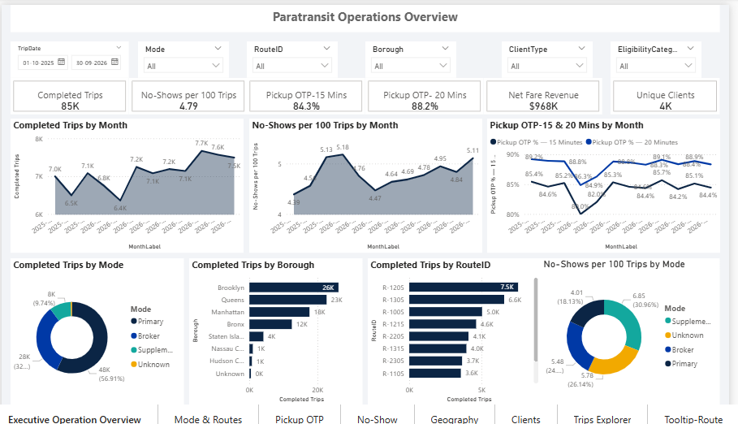

# Paratransit Trips Analytics Dashboard (Power BI)

A seven-page Power BI report on paratransit trips: service volume, pickup on-time performance, no-shows, geography and client behaviour. Built end to end: a Python data generator, Power Query cleaning, a two-table star model, DAX measures and the report.

> **All data is synthetic.** It is generated by a script, inspired by public paratransit service concepts. It is not real MTA or Access-A-Ride data and contains no real people.

## Business questions
- How many trips are scheduled, completed, cancelled and no-shows?
- How reliable is pickup service (on time within 15 and 20 minutes) by mode, route, borough and time of day?
- Which routes and areas underperform, and is the sample large enough to say so?
- Who uses the service, and how often?

## What I built
| Stage | What it covers |
|---|---|
| Data generation | Seeded Python script producing 5,000 clients and about 100,000 trips, with deliberate data problems added |
| Data cleaning | Power Query: duplicate removal, type fixes, text cleanup, date repair, validity flags, mode from route number, age as of 30 Sep 2026 |
| Model | Two tables: Clients (one) to Trips (many), single-direction relationship |
| DAX | About 60 measures: OTP 15 and 20 minutes, no-shows per 100 trips, revenue, ranking, rolling windows |
| Report | Seven pages with synced slicers, drill-through, tooltips and bookmarks |

## Key results (full period, Oct 2025 to Sep 2026)
- 99,943 valid scheduled trips; 85,087 completed.
- No-shows: 4.79 per 100 eligible trips.
- Pickup on-time performance: 84.3% within 15 minutes, 88.2% within 20 minutes.
- By mode, on-time within 15 minutes: Primary 89.0%, Broker 79.1%, Supplemental 74.1%.
- Routes R-3105 and R-2105 stand out as underperformers.
- 4,183 of 5,000 clients rode at least once; 1,154 took 20 or more trips.

## Report pages
1. Executive operations overview
2. Mode and route performance
3. Pickup on-time analysis
4. No-show analysis
5. Geography
6. Clients
7. Trip explorer

## Repository contents
- `docs/` data dictionary, data quality report, Power Query tutorial, DAX guide, QA checklist
- `powerquery/` the M code for the Clients and Trips queries
- `scripts/` `generate_data.py` (creates the raw CSVs) and `reference_clean.py` (an independent check of the numbers)
- `data/` Clients.csv; Trips.csv is not stored here because of GitHub's file-size limit
- `screenshots/` one image per report page

## How to recreate the data
1. Install Python 3 with pandas.
2. Run `python generate_data.py`. It uses a fixed random seed, so it produces the same files every time, including Trips.csv.
3. Open the report, set the folder parameter `pFolder` to the folder with the CSVs, and refresh.

## Tools
Power BI Desktop, Power Query (M), DAX, Python (pandas).

## Author
Ajay Sharma, [LinkedIn](https://www.linkedin.com/in/ajaysharma-da/)
